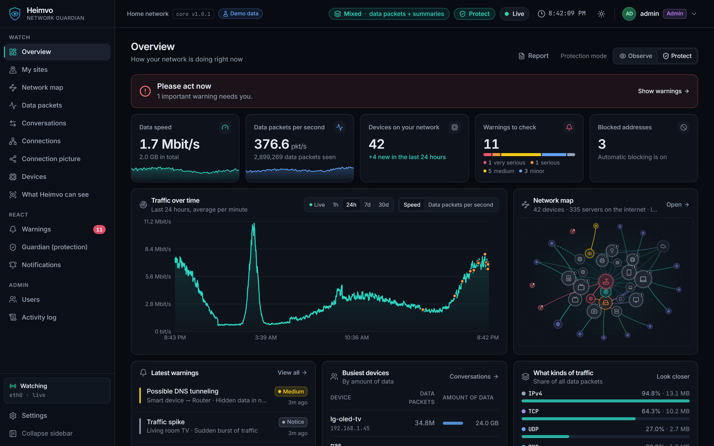
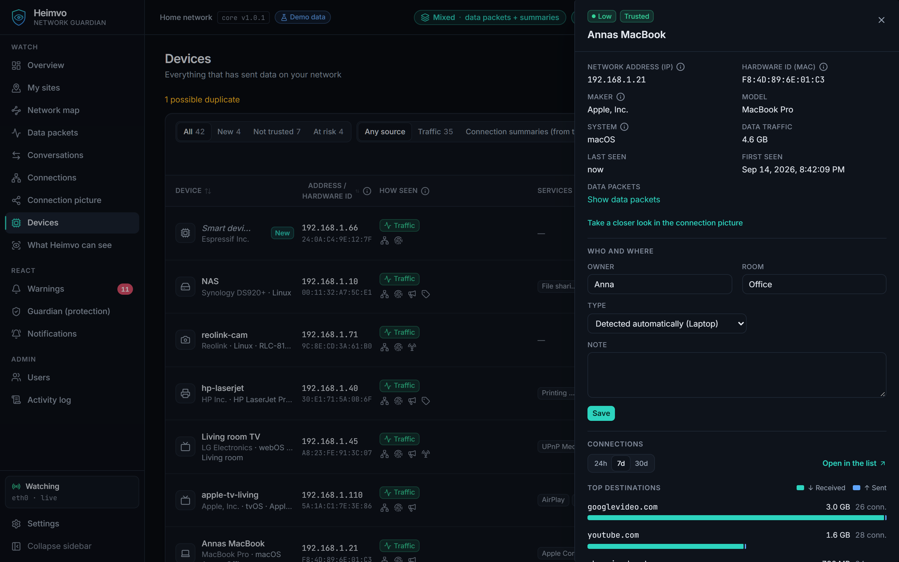
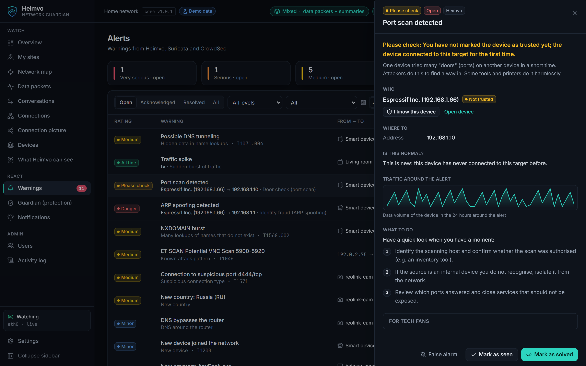
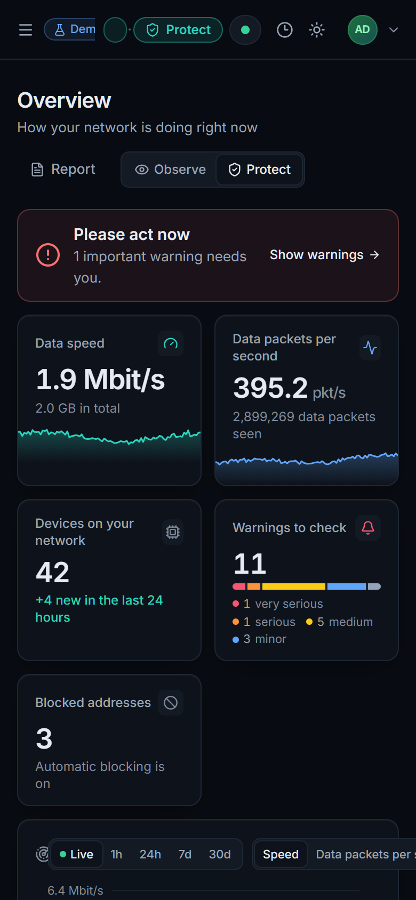

<div align="center">

[Deutsch](README.md) · **English**


<br/>

### Your network, finally easy to understand.

Heimvo shows which devices are on your Wi-Fi, with names like **"Samsung Galaxy S26 Ultra"** instead of `192.168.178.37`.<br/>
It reports unknown devices and attacks in plain language and can block them automatically. Everything runs locally on your PC, no cloud account.

<br/>

## [⬇ Download Heimvo for Windows](https://github.com/Reinert-Digital/heimvo-releases/releases/latest)

<sub>Windows 10 and 11 (64-bit) · English and German · Free to use, try Pro for free</sub>

<br/>



</div>

---

## What Heimvo does for you

| 📱 Every device has a name | 🚨 Warnings in plain language | 🛡️ Block with one click |
|---|---|---|
| `none-2` becomes **Amazon Echo**, `wpad.fritz.box` becomes **FRITZ!Box 6670**. Assign owner and room: "Anna's iPhone, living room". | An unknown device, a port scan or a program quietly sending data? Heimvo explains what happened and what you can do. | Block suspicious addresses right in Heimvo or let it block them automatically. Your router and your own devices are protected from that. |



## Install in 3 steps

1. **Download:** Open the [latest version](https://github.com/Reinert-Digital/heimvo-releases/releases/latest) and download `Heimvo-Setup-<version>.exe`.
2. **Install:** Double-click the file. If **"Windows protected your PC"** appears, click **More info** and then **Run anyway** (explained [below](#why-does-windows-warn-me)). Confirm the User Account Control prompt with **Yes**.
3. **Get started:** The assistant helps you install the free capture driver **Npcap** and creates your Heimvo account (password with at least 10 characters). Heimvo then opens and you sign in. From now on Heimvo runs in the background, also after a restart.

### System requirements

- Windows 10 or 11, 64-bit, an account with administrator rights
- A PC that is on in your home network, ideally connected by cable
- Npcap (free, the installer helps you download it)

**Other platforms:** Every version also includes a Linux package (`.deb` for amd64/arm64, signed) and images for a dedicated Heimvo box on a Raspberry Pi 5 or an x86 mini PC. The box images are a preview: tested in a virtual machine, tests on real hardware are still running.

## Why does Windows warn me?

The installer is **not digitally signed yet**. That is why Microsoft SmartScreen does not know it and shows "Unknown publisher". Signing is in progress.

**How to check that the file is genuine:** From the same version, also download `Heimvo-Setup-<version>.exe.sha256`. Then run this in PowerShell in your download folder:

```powershell
Get-FileHash .\Heimvo-Setup-x.y.z.exe -Algorithm SHA256
```

The `Hash` shown must match the text in the `.sha256` file. If it differs, do not run the file and download it again.

## Free and Pro

| | **Free** | **Pro** |
|---|:---:|:---:|
| Device list with name, type, owner and room | ✅ | ✅ |
| Warnings in plain language, traffic light, network map | ✅ | ✅ |
| Blocking by hand and automatically | ✅ | ✅ |
| Notifications by email, Telegram, Teams, Slack or push | ✅ | ✅ |
| Weekly and monthly report | | ✅ |
| Family protection | | ✅ |
| **Block** and **False alarm** right from the push notification | | ✅ |
| Connection picture | | ✅ |

## Your data stays with you

- Heimvo runs **only on your PC**. There is no cloud account and no telemetry.
- Heimvo cannot see the content of encrypted websites, only which service received how much data and when.
- Heimvo honestly shows how much of the network it can see. On a normal PC that is mainly the devices and their announcements; for the full picture, a mirror port or gateway mode helps.

<table>
<tr>
<td width="62%"></td>
<td width="38%" align="center"></td>
</tr>
<tr>
<td><sub>Warnings explain what happened.</sub></td>
<td align="center"><sub>Also in your phone's browser.</sub></td>
</tr>
</table>

## FAQ

**Do I need new hardware?** No. A Windows PC in your home network is enough.

**How do I update?** Download the new version and install it over the old one. Your settings and devices are kept.

**Why is a device only called "Phone (Android)"?** Some devices do not reveal a name. Give it your own name in Heimvo; Heimvo never overwrites it.

**May I monitor any network?** Only networks that belong to you or that you have permission to monitor.

## Contact

Questions, feedback or interest in Heimvo for your practice or office:
**contact@reinert-digital.de**

Found a bug? [Report it here](https://github.com/Reinert-Digital/heimvo-releases/issues/new/choose).
Please report security issues confidentially, see [SECURITY.md](SECURITY.md).

Release notes are attached to each [version](https://github.com/Reinert-Digital/heimvo-releases/releases).

---

<div align="center">
<sub>Heimvo is a product of <a href="https://reinert-digital.de">Reinert Digital Solutions</a>, Düsseldorf, Germany · © 2026 · All rights reserved</sub>
</div>
