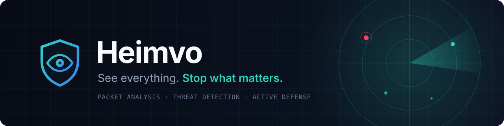
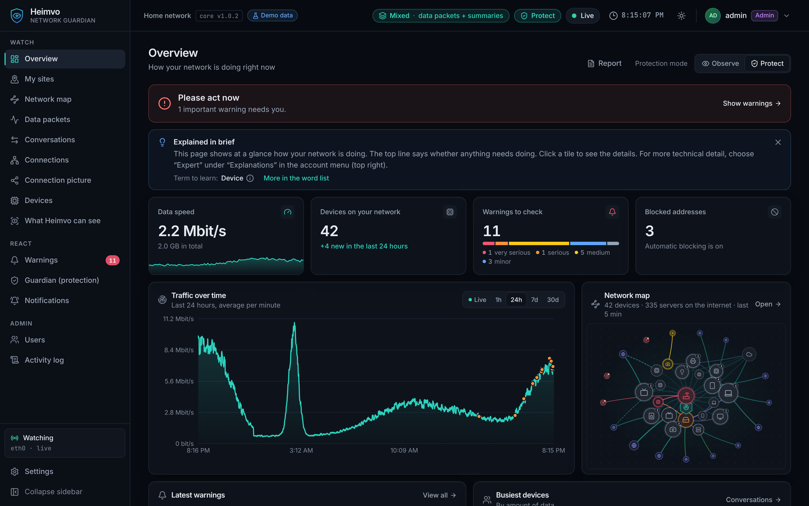
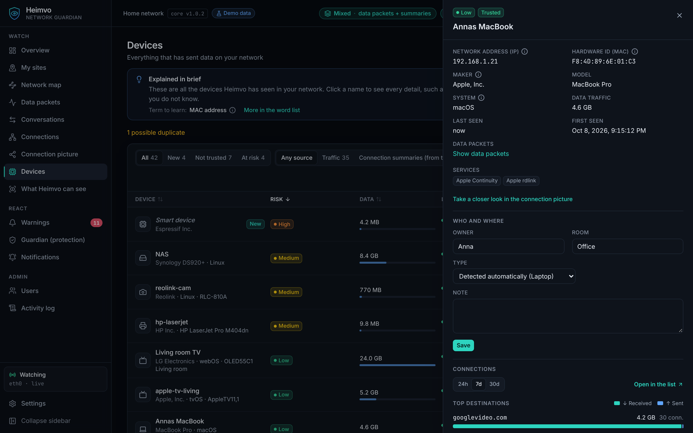
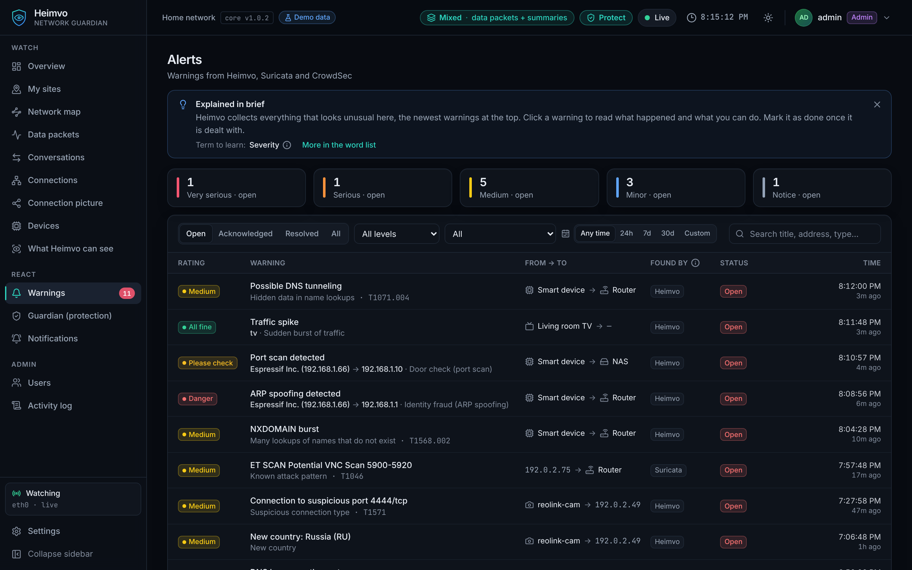
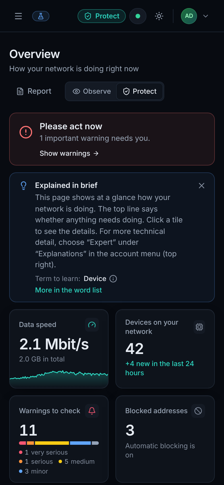

<div align="center">

[Deutsch](README.md) · **English**



<br/>

### Your network, finally easy to understand.

Heimvo shows which devices are on your Wi-Fi, with names like **"Samsung Galaxy S26 Ultra"** instead of `192.168.178.37`.<br/>
It reports unknown devices and attacks in plain language and can block them automatically. Everything runs locally on your PC, no cloud account.

<br/>

[](https://github.com/Reinert-Digital/heimvo-releases/releases/latest)


<br/>

## [⬇ Download Heimvo for Windows](https://github.com/Reinert-Digital/heimvo-releases/releases/latest)

<sub>Windows 10 and 11 (64-bit) · English and German · Free to use · Pro is free during launch</sub>

<br/>



[Why Heimvo](#why-we-built-heimvo) · [Features](#what-heimvo-does-for-you) · [Who it is for](#who-is-heimvo-for) · [Install](#install-in-3-steps) · [Free and Pro](#free-and-pro) · [Contact](#about-reinert-digital-solutions)

</div>

---

## Why we built Heimvo

Every home and every small office now has dozens of devices on its Wi-Fi: phones, laptops, TVs, speakers, cameras, smart plugs. Hardly anyone knows exactly which ones they are, or whether a stranger is among them.

The existing tools do not help much. The router shows lists with names like `none-2` and `4C53FDFFFC69`. Expert tools show every single packet but explain nothing. Enterprise security products are expensive and need an IT team of their own.

We built Heimvo to close that gap: **the detection of an expert tool, explained so that anyone understands it.** Three principles guide us:

| 💬 Understandable | 🔒 Local | 🔍 Honest |
|---|---|---|
| Plain language instead of jargon. Every warning says what happened and what you can do now. | Your network data stays on your PC. No cloud account, no telemetry, not even we can see it. | Heimvo openly shows how much of the network it can see and where its limits are. |

## What Heimvo does for you

| 📱 Every device has a name | 🚨 Warnings in plain language | 🛡️ Block with one click |
|---|---|---|
| `none-2` becomes **Amazon Echo**, `wpad.fritz.box` becomes **FRITZ!Box 6670**. Assign owner and room: "Anna's iPhone, living room". | An unknown device, a port scan or a program quietly sending data? Heimvo explains what happened and what you can do. | Block suspicious addresses right in Heimvo or let it block them automatically. Your router and your own devices are protected from that. |



## Easy for beginners, complete for experts

You choose how much technical detail Heimvo shows, and you can switch at any time in the account menu:

- **Beginner:** plain language and only what matters on each page. A short **"Explained in brief"** note says what the page shows and what to do, and explains one technical term on the way. That way you get to know your network step by step.
- **Simple:** everyday words and short sentences, easy to follow from about age 15.
- **Expert:** every detail with the technical terms, from IP and MAC addresses down to single data packets.

## Who is Heimvo for?

| 👨‍👩‍👧 Families | 🏥 Medical practices, law firms, offices | 🧪 Tech enthusiasts |
|---|---|---|
| See which devices are on the Wi-Fi and get notified right away when an unknown one shows up. | Notice unusual traffic early. With roles for staff and a log of who did what. | Expert view with packet analysis, connections and DNS log, all local on your own machine. |

## Install in 3 steps

1. **Download:** Open the [latest version](https://github.com/Reinert-Digital/heimvo-releases/releases/latest) and download `Heimvo-Setup-<version>.exe`.
2. **Install:** Double-click the file. If **"Windows protected your PC"** appears, click **More info** and then **Run anyway** (explained [below](#why-does-windows-warn-me)). Confirm the User Account Control prompt with **Yes**.
3. **Get started:** The assistant helps you install the free capture driver **Npcap** and creates your Heimvo account (password with at least 10 characters). Heimvo then opens and you sign in. From now on Heimvo runs in the background, also after a restart.

### System requirements

- Windows 10 or 11, 64-bit, an account with administrator rights
- A PC that is on in your home network, ideally connected by cable
- Npcap (free, the installer helps you download it)

**Other platforms:** Every version also includes a Linux package (`.deb` for amd64/arm64, signed) and images for a dedicated Heimvo box on a Raspberry Pi 5 or an x86 mini PC. The box images are a preview: tested in a virtual machine, tests on real hardware are still running.

## Why does Windows warn me?

The installer is **not digitally signed yet**. That is why Microsoft SmartScreen does not know it and shows "Unknown publisher". Signing is in progress.

**How to check that the file is genuine:** From the same version, also download `Heimvo-Setup-<version>.exe.sha256`. Then run this in PowerShell in your download folder:

```powershell
Get-FileHash .\Heimvo-Setup-x.y.z.exe -Algorithm SHA256
```

The `Hash` shown must match the text in the `.sha256` file. If it differs, do not run the file and download it again.

## Free and Pro

| | **Free** | **Pro** |
|---|:---:|:---:|
| Device list with name, type, owner and room | ✅ | ✅ |
| Warnings in plain language, traffic light, network map | ✅ | ✅ |
| Blocking by hand and automatically | ✅ | ✅ |
| Notifications by email, Telegram, Teams, Slack or push | ✅ | ✅ |
| Weekly and monthly report | | ✅ |
| Family protection | | ✅ |
| **Block** and **False alarm** right from the push notification | | ✅ |
| Connection picture | | ✅ |
| Several sites at a glance | | ✅ |

> **🎁 Launch phase: Pro is free.**
> After installing, all Pro features are unlocked for 30 days automatically. Want to keep Pro after that? Email us at **contact@reinert-digital.de** with your name or company name. You get a free Pro key, valid until 30 June 2027. Enter it under **Settings → License**.

## Your data stays with you

- Heimvo runs **only on your PC**. There is no cloud account and no telemetry.
- Heimvo cannot see the content of encrypted websites, only which service received how much data and when.
- Heimvo honestly shows how much of the network it can see. On a normal PC that is mainly the devices and their announcements; for the full picture, a mirror port or gateway mode helps.

<table>
<tr>
<td width="62%"></td>
<td width="38%" align="center"></td>
</tr>
<tr>
<td><sub>Warnings explain what happened.</sub></td>
<td align="center"><sub>Also in your phone's browser.</sub></td>
</tr>
</table>

## FAQ

**Do I need new hardware?** No. A Windows PC in your home network is enough.

**I know nothing about networks. Is Heimvo still for me?** Yes. In the account menu, choose "Beginner" or "Simple" under "Explanations". Heimvo then shows only what matters and explains every page in brief.

**What does Pro cost?** Nothing during the launch phase. Email us and you get a free Pro key valid until 30 June 2027 (see [Free and Pro](#free-and-pro)). The free version stays free for good.

**How do I update?** Download the new version and install it over the old one. Your settings and devices are kept.

**Why is a device only called "Phone (Android)"?** Some devices do not reveal a name. Give it your own name in Heimvo; Heimvo never overwrites it.

**May I monitor any network?** Only networks that belong to you or that you have permission to monitor.

## About Reinert Digital Solutions

Heimvo is developed by [Reinert Digital Solutions](https://reinert-digital.de), a digital agency from Düsseldorf, Germany. We build websites and software for businesses and develop our own products such as Heimvo.

Want to use Heimvo in your practice or office, have feedback, or looking for a partner for your own software project? Write to us: **contact@reinert-digital.de**

Found a bug? [Report it here](https://github.com/Reinert-Digital/heimvo-releases/issues/new/choose).
Please report security issues confidentially, see [SECURITY.md](SECURITY.md).

Release notes are attached to each [version](https://github.com/Reinert-Digital/heimvo-releases/releases).

---

<div align="center">
<sub>Heimvo is a product of <a href="https://reinert-digital.de">Reinert Digital Solutions</a>, Düsseldorf, Germany · © 2026 · All rights reserved</sub>
</div>
