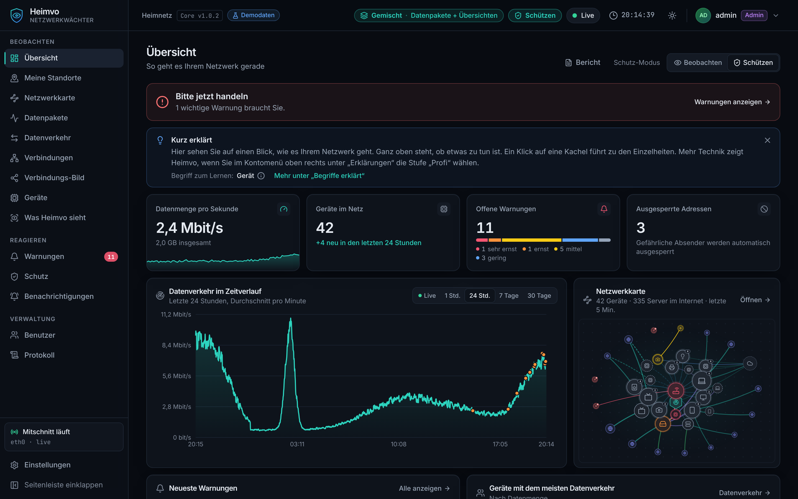
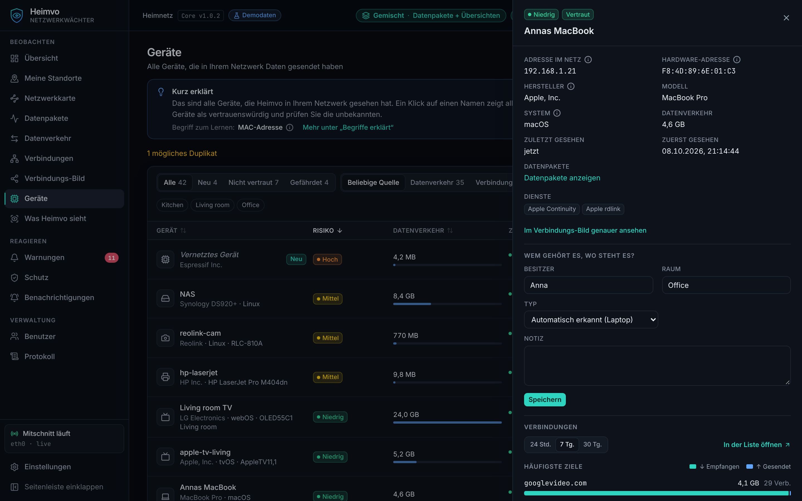
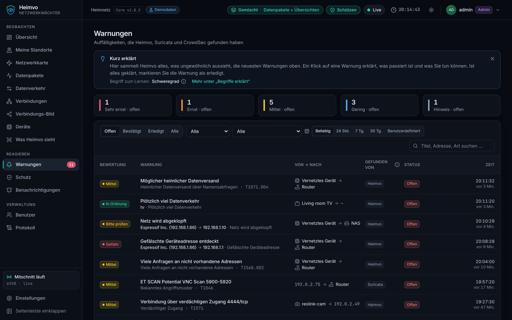
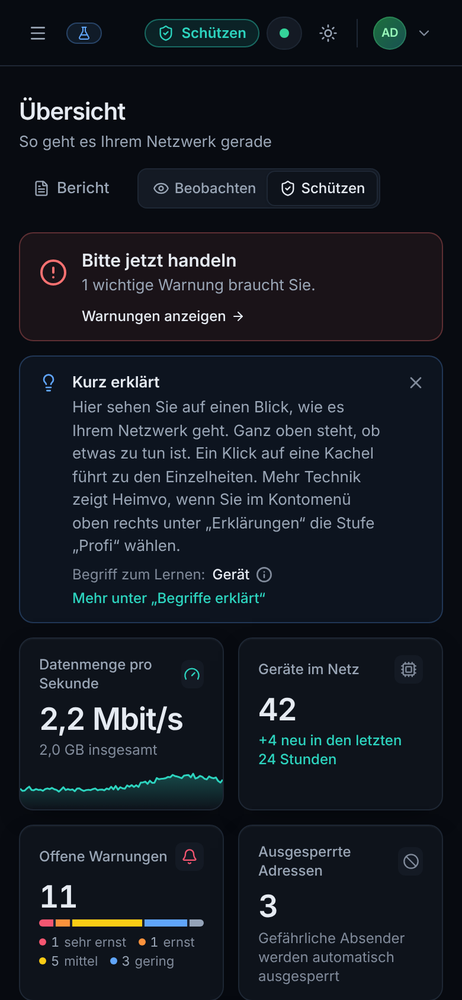

<div align="center">

**Deutsch** · [English](README.en.md)


<br/>

### Ihr Netzwerk, endlich verständlich.

Heimvo zeigt, welche Geräte in Ihrem WLAN sind, mit Namen wie **„Samsung Galaxy S26 Ultra“** statt `192.168.178.37`.<br/>
Es meldet fremde Geräte und Angriffe in Klartext und sperrt sie auf Wunsch automatisch. Alles läuft lokal auf Ihrem PC, ohne Cloud-Konto.

<br/>

[](https://github.com/Reinert-Digital/heimvo-releases/releases/latest)


<br/>

## [⬇ Heimvo für Windows herunterladen](https://github.com/Reinert-Digital/heimvo-releases/releases/latest)

<sub>Windows 10 und 11 (64-Bit) · Deutsch und Englisch · Kostenlos nutzbar · Pro in der Startphase kostenlos<br/>Mit dem Download gelten die <a href="NUTZUNGSBEDINGUNGEN.md">Nutzungsbedingungen</a>.</sub>

<br/>



[Warum Heimvo](#warum-wir-heimvo-gebaut-haben) · [Funktionen](#was-heimvo-für-sie-tut) · [Für wen](#für-wen-ist-heimvo) · [Installation](#installation-in-3-schritten) · [Kostenlos und Pro](#kostenlos-und-pro) · [Kontakt](#über-reinert-digital-solutions)

</div>

---

## Warum wir Heimvo gebaut haben

In jedem Zuhause und jedem kleinen Büro hängen heute Dutzende Geräte im WLAN: Handys, Laptops, Fernseher, Lautsprecher, Kameras, smarte Steckdosen. Kaum jemand weiß, welche das genau sind und ob ein fremdes dabei ist.

Die vorhandenen Werkzeuge helfen dabei wenig. Der Router zeigt Listen mit Namen wie `none-2` und `4C53FDFFFC69`. Profi-Programme zeigen jedes Datenpaket, erklären aber nichts. Sicherheitslösungen für Firmen sind teuer und brauchen ein eigenes IT-Team.

Diese Lücke wollten wir schließen: **die Erkennung eines Profi-Werkzeugs, erklärt so, dass es jeder versteht.** Drei Grundsätze leiten uns dabei:

| 💬 Verständlich | 🔒 Lokal | 🔍 Ehrlich |
|---|---|---|
| Klare Sprache statt Fachchinesisch. Jede Warnung sagt, was passiert ist und was Sie jetzt tun können. | Ihre Netzwerkdaten bleiben auf Ihrem PC. Kein Cloud-Konto, keine Telemetrie, auch wir sehen nichts. | Heimvo zeigt offen, wie viel vom Netz es sehen kann und wo seine Grenzen sind. |

## Was Heimvo für Sie tut

| 📱 Jedes Gerät mit Namen | 🚨 Warnungen in Klartext | 🛡️ Mit einem Klick sperren |
|---|---|---|
| Aus `none-2` wird **Amazon Echo**, aus `wpad.fritz.box` die **FRITZ!Box 6670**. Ordnen Sie Besitzer und Raum zu: „Annas iPhone, Wohnzimmer“. | Ein unbekanntes Gerät, ein Port-Scan oder ein Programm, das heimlich Daten sendet? Heimvo erklärt, was passiert ist und was Sie tun können. | Verdächtige Adressen sperren Sie direkt in Heimvo oder lassen sie automatisch sperren. Router und eigene Geräte sind davor geschützt. |



## Verständlich für Einsteiger, vollständig für Profis

Sie wählen selbst, wie viel Technik Heimvo zeigt, und können jederzeit im Kontomenü wechseln:

- **Einsteiger:** klare Sprache, nur das Wichtigste auf jeder Seite. Ein kurzer Kasten **„Kurz erklärt“** sagt, was die Seite zeigt und was zu tun ist, und erklärt nebenbei einen Fachbegriff. So lernen Sie Ihr Netzwerk Schritt für Schritt kennen.
- **Einfach:** Alltagswörter und kurze Sätze, verständlich ab etwa 15 Jahren.
- **Profi:** alle Details mit Fachbegriffen, von IP- und MAC-Adresse bis zum einzelnen Datenpaket.

## Für wen ist Heimvo?

| 👨‍👩‍👧 Familien | 🏥 Praxis, Kanzlei und Büro | 🧪 Technik-Fans |
|---|---|---|
| Sehen, welche Geräte im WLAN sind, und sofort Bescheid bekommen, wenn ein fremdes auftaucht. | Auffälligen Datenverkehr früh bemerken. Mit Rollen für Mitarbeitende und einem Protokoll, wer was getan hat. | Profi-Ansicht mit Paketanalyse, Verbindungen und DNS-Protokoll, alles lokal auf dem eigenen Rechner. |

## Installation in 3 Schritten

1. **Herunterladen:** Öffnen Sie die [neueste Version](https://github.com/Reinert-Digital/heimvo-releases/releases/latest) und laden Sie `Heimvo-Setup-<Version>.exe` herunter.
2. **Installieren:** Doppelklicken Sie die Datei. Erscheint **„Der Computer wurde durch Windows geschützt“**, klicken Sie auf **Weitere Informationen** und dann auf **Trotzdem ausführen** (Erklärung [unten](#warum-warnt-windows)). Bestätigen Sie die Abfrage der Benutzerkontensteuerung mit **Ja**.
3. **Loslegen:** Der Assistent hilft beim kostenlosen Aufzeichnungs-Treiber **Npcap** und legt Ihr Heimvo-Konto an (Passwort mit mindestens 10 Zeichen). Danach öffnet sich Heimvo, und Sie melden sich an. Heimvo läuft ab jetzt im Hintergrund, auch nach einem Neustart.

### Systemanforderungen

- Windows 10 oder 11, 64-Bit, Konto mit Administratorrechten
- Ein PC, der im Heimnetz läuft, am besten per LAN-Kabel
- Npcap (kostenlos, der Installer hilft beim Herunterladen)

**Weitere Plattformen:** In jeder Version liegen auch ein Linux-Paket (`.deb` für amd64/arm64, mit Signatur) und Images für eine eigene Heimvo-Box auf Raspberry Pi 5 oder x86-Mini-PC. Die Box-Images sind eine Vorschau: getestet in der virtuellen Maschine, Tests auf echter Hardware laufen noch.

## Warum warnt Windows?

Der Installer ist **noch nicht digital signiert**. Deshalb kennt Microsoft SmartScreen ihn nicht und zeigt „Unbekannter Herausgeber“. Die Signatur ist in Arbeit.

**So prüfen Sie, dass die Datei echt ist:** Laden Sie aus derselben Version auch `Heimvo-Setup-<Version>.exe.sha256` herunter. Führen Sie dann in PowerShell im Download-Ordner aus:

```powershell
Get-FileHash .\Heimvo-Setup-x.y.z.exe -Algorithm SHA256
```

Der angezeigte `Hash` muss mit dem Text in der `.sha256`-Datei übereinstimmen. Weicht er ab, starten Sie die Datei nicht und laden Sie sie neu herunter.

## Kostenlos und Pro

| | **Kostenlos** | **Pro** |
|---|:---:|:---:|
| Geräteliste mit Namen, Typ, Besitzer und Raum | ✅ | ✅ |
| Warnungen in Klartext, Ampel, Netzwerkkarte | ✅ | ✅ |
| Sperren von Hand und automatisch | ✅ | ✅ |
| Benachrichtigung per E-Mail, Telegram, Teams, Slack oder Push | ✅ | ✅ |
| Wochen- und Monatsbericht | | ✅ |
| Familien-Schutz | | ✅ |
| **Sperren** und **Fehlalarm** direkt aus der Push-Nachricht | | ✅ |
| Verbindungs-Bild | | ✅ |
| Mehrere Standorte zentral im Blick | | ✅ |

> **🎁 Startphase: Pro ist kostenlos.**
> Nach der Installation sind alle Pro-Funktionen 30 Tage lang automatisch offen. Möchten Sie Pro danach weiter nutzen, schreiben Sie uns mit Ihrem Namen oder Firmennamen an **contact@reinert-digital.de**. Sie bekommen einen kostenlosen Pro-Schlüssel, gültig bis 30.06.2027. Eintragen unter **Einstellungen → Lizenz**.

## Ihre Daten bleiben bei Ihnen

- Heimvo läuft **nur auf Ihrem PC**. Es gibt kein Cloud-Konto und keine Telemetrie.
- Inhalte verschlüsselter Webseiten sieht Heimvo nicht, nur, welcher Dienst wann wie viele Daten bekommen hat.
- Heimvo zeigt ehrlich an, wie viel vom Netz es sieht. Auf einem normalen PC sind das vor allem die Geräte und ihre Ankündigungen; für den vollen Blick hilft ein Mirror-Port oder der Gateway-Betrieb.

<table>
<tr>
<td width="62%"></td>
<td width="38%" align="center"></td>
</tr>
<tr>
<td><sub>Warnungen erklären, was passiert ist.</sub></td>
<td align="center"><sub>Auch im Handy-Browser.</sub></td>
</tr>
</table>

## Häufige Fragen

**Brauche ich neue Hardware?** Nein. Ein Windows-PC im Heimnetz genügt.

**Ich kenne mich mit Netzwerken nicht aus. Ist Heimvo trotzdem etwas für mich?** Ja. Wählen Sie im Kontomenü unter „Erklärungen“ die Stufe „Einsteiger“ oder „Einfach“. Dann zeigt Heimvo nur das Wichtige und erklärt jede Seite kurz.

**Was kostet Pro?** In der Startphase nichts. Schreiben Sie uns, und Sie bekommen einen kostenlosen Pro-Schlüssel bis 30.06.2027 (siehe [Kostenlos und Pro](#kostenlos-und-pro)). Die kostenlose Version bleibt dauerhaft kostenlos.

**Wie aktualisiere ich?** Laden Sie die neue Version herunter und installieren Sie sie darüber. Ihre Einstellungen und Geräte bleiben erhalten.

**Warum heißt ein Gerät nur „Handy (Android)“?** Manche Geräte verraten keinen Namen. Geben Sie ihm in Heimvo einen eigenen Namen; den überschreibt Heimvo nie.

**Darf ich jedes Netz überwachen?** Nur Netze, die Ihnen gehören oder für die Sie die Erlaubnis haben.

**Was muss ich in Praxis, Kanzlei oder Büro beachten?** Nutzen Mitarbeitende, Patientinnen und Patienten oder Gäste das Netz, sieht Heimvo auch deren Geräte und Verbindungsdaten (wer wann mit welchem Dienst wie viele Daten austauscht, keine Inhalte verschlüsselter Verbindungen). Dafür gilt die DSGVO: Sie brauchen eine Rechtsgrundlage, sollten die Betroffenen vorher informieren und den Einsatz in Ihr Verzeichnis der Verarbeitungstätigkeiten aufnehmen. Gibt es einen Betriebsrat, muss er in der Regel zustimmen (§ 87 Abs. 1 Nr. 6 BetrVG). Stellen Sie die Aufbewahrungsdauer in den Einstellungen so kurz wie möglich ein. Im Zweifel fragen Sie Ihre Datenschutzbeauftragte oder Ihren Datenschutzbeauftragten.

## Über Reinert Digital Solutions

Heimvo wird von [Reinert Digital Solutions](https://reinert-digital.de) entwickelt, einer Digitalagentur aus Düsseldorf. Wir bauen Websites und Software für Unternehmen und entwickeln eigene Produkte wie Heimvo.

Sie möchten Heimvo in Ihrer Praxis oder Ihrem Büro einsetzen, haben Feedback oder suchen einen Partner für Ihr eigenes Software-Projekt? Schreiben Sie uns: **contact@reinert-digital.de**

Einen Fehler gefunden? [Hier melden](https://github.com/Reinert-Digital/heimvo-releases/issues/new/choose).
Sicherheitslücken bitte vertraulich, siehe [SECURITY.md](SECURITY.md).

Die Versionshinweise stehen bei jeder [Version](https://github.com/Reinert-Digital/heimvo-releases/releases).

---

<div align="center">
<sub>Heimvo ist ein Produkt von <a href="https://reinert-digital.de">Reinert Digital Solutions</a>, Düsseldorf · © 2026 · Alle Rechte vorbehalten<br/><a href="NUTZUNGSBEDINGUNGEN.md">Nutzungsbedingungen</a> · <a href="https://reinert-digital.de/impressum/">Impressum</a> · <a href="https://reinert-digital.de/datenschutz/">Datenschutz</a></sub>
</div>
