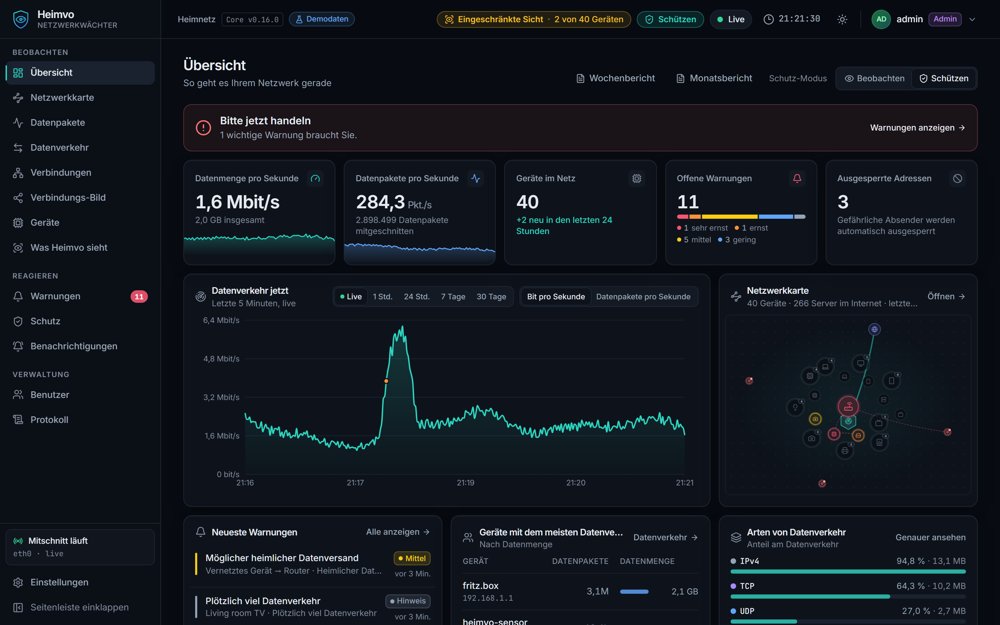
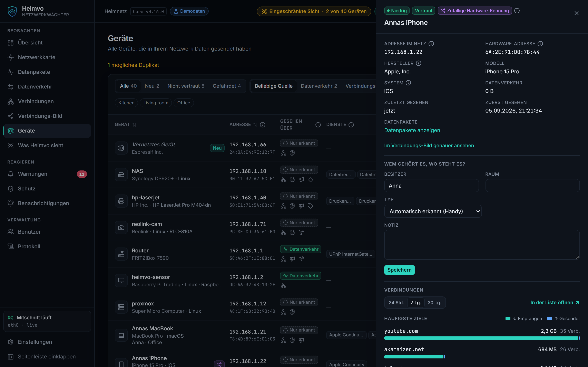
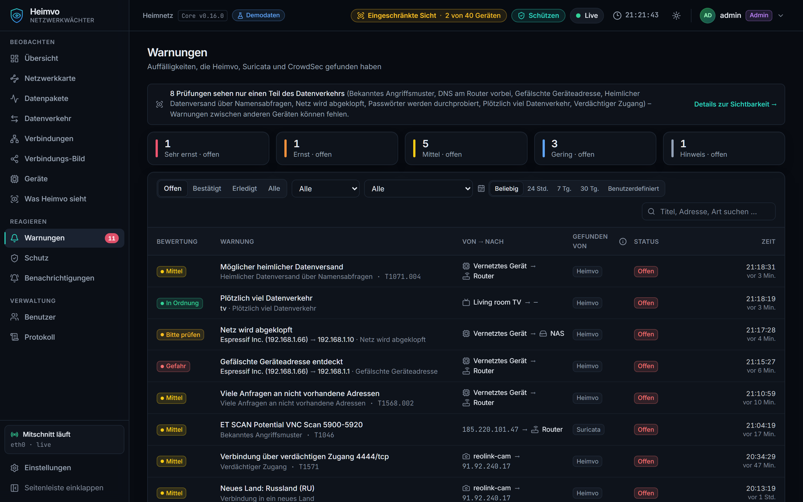
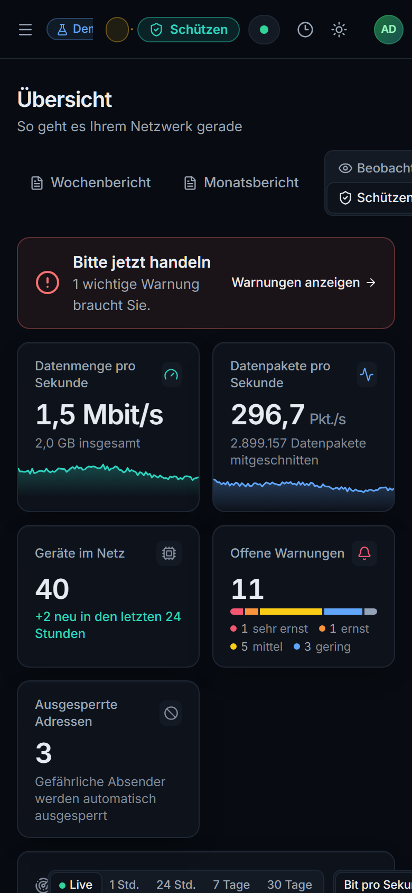

<div align="center">


<br/>

### Ihr Netzwerk, endlich verständlich.

Heimvo zeigt, welche Geräte in Ihrem WLAN sind, mit Namen wie **„Samsung Galaxy S26 Ultra“** statt `192.168.178.37`.<br/>
Es meldet fremde Geräte und Angriffe in Klartext und sperrt sie auf Wunsch automatisch. Alles läuft lokal auf Ihrem PC, ohne Cloud-Konto.

<br/>

## [⬇ Heimvo für Windows herunterladen](https://github.com/Reinert-Digital/heimvo-releases/releases/latest)

<sub>Windows 10 und 11 (64-Bit) · Deutsch und Englisch · Kostenlos nutzbar, Pro kostenlos testen</sub>

<br/>



</div>

---

## Was Heimvo für Sie tut

| 📱 Jedes Gerät mit Namen | 🚨 Warnungen in Klartext | 🛡️ Mit einem Klick sperren |
|---|---|---|
| Aus `none-2` wird **Amazon Echo**, aus `wpad.fritz.box` die **FRITZ!Box 6670**. Ordnen Sie Besitzer und Raum zu: „Annas iPhone, Wohnzimmer“. | Ein unbekanntes Gerät, ein Port-Scan oder ein Programm, das heimlich Daten sendet? Heimvo erklärt, was passiert ist und was Sie tun können. | Verdächtige Adressen sperren Sie direkt in Heimvo oder lassen sie automatisch sperren. Router und eigene Geräte sind davor geschützt. |



## Installation in 3 Schritten

1. **Herunterladen:** Öffnen Sie die [neueste Version](https://github.com/Reinert-Digital/heimvo-releases/releases/latest) und laden Sie `Heimvo-Setup-<Version>.exe` herunter.
2. **Installieren:** Doppelklicken Sie die Datei. Erscheint **„Der Computer wurde durch Windows geschützt“**, klicken Sie auf **Weitere Informationen** und dann auf **Trotzdem ausführen** (Erklärung [unten](#warum-warnt-windows)). Bestätigen Sie die Abfrage der Benutzerkontensteuerung mit **Ja**.
3. **Loslegen:** Der Assistent hilft beim kostenlosen Aufzeichnungs-Treiber **Npcap** und legt Ihr Heimvo-Konto an (Passwort mit mindestens 10 Zeichen). Danach öffnet sich Heimvo, und Sie melden sich an. Heimvo läuft ab jetzt im Hintergrund, auch nach einem Neustart.

### Systemanforderungen

- Windows 10 oder 11, 64-Bit, Konto mit Administratorrechten
- Ein PC, der im Heimnetz läuft, am besten per LAN-Kabel
- Npcap (kostenlos, der Installer hilft beim Herunterladen)

## Warum warnt Windows?

Der Installer ist **noch nicht digital signiert**. Deshalb kennt Microsoft SmartScreen ihn nicht und zeigt „Unbekannter Herausgeber“. Die Signatur ist in Arbeit.

**So prüfen Sie, dass die Datei echt ist:** Laden Sie aus derselben Version auch `Heimvo-Setup-<Version>.exe.sha256` herunter. Führen Sie dann in PowerShell im Download-Ordner aus:

```powershell
Get-FileHash .\Heimvo-Setup-x.y.z.exe -Algorithm SHA256
```

Der angezeigte `Hash` muss mit dem Text in der `.sha256`-Datei übereinstimmen. Weicht er ab, starten Sie die Datei nicht und laden Sie sie neu herunter.

## Kostenlos und Pro

| | **Kostenlos** | **Pro** |
|---|:---:|:---:|
| Geräteliste mit Namen, Typ, Besitzer und Raum | ✅ | ✅ |
| Warnungen in Klartext, Ampel, Netzwerkkarte | ✅ | ✅ |
| Sperren von Hand und automatisch | ✅ | ✅ |
| Benachrichtigung per E-Mail, Telegram, Teams, Slack oder Push | ✅ | ✅ |
| Wochen- und Monatsbericht | | ✅ |
| Familien-Schutz | | ✅ |
| **Sperren** und **Fehlalarm** direkt aus der Push-Nachricht | | ✅ |
| Verbindungs-Bild | | ✅ |

## Ihre Daten bleiben bei Ihnen

- Heimvo läuft **nur auf Ihrem PC**. Es gibt kein Cloud-Konto und keine Telemetrie.
- Inhalte verschlüsselter Webseiten sieht Heimvo nicht, nur, welcher Dienst wann wie viele Daten bekommen hat.
- Heimvo zeigt ehrlich an, wie viel vom Netz es sieht. Auf einem normalen PC sind das vor allem die Geräte und ihre Ankündigungen; für den vollen Blick hilft ein Mirror-Port oder der Gateway-Betrieb.

<table>
<tr>
<td width="62%"></td>
<td width="38%" align="center"></td>
</tr>
<tr>
<td><sub>Warnungen erklären, was passiert ist.</sub></td>
<td align="center"><sub>Auch im Handy-Browser.</sub></td>
</tr>
</table>

## Häufige Fragen

**Brauche ich neue Hardware?** Nein. Ein Windows-PC im Heimnetz genügt.

**Wie aktualisiere ich?** Laden Sie die neue Version herunter und installieren Sie sie darüber. Ihre Einstellungen und Geräte bleiben erhalten.

**Warum heißt ein Gerät nur „Handy (Android)“?** Manche Geräte verraten keinen Namen. Geben Sie ihm in Heimvo einen eigenen Namen; den überschreibt Heimvo nie.

**Darf ich jedes Netz überwachen?** Nur Netze, die Ihnen gehören oder für die Sie die Erlaubnis haben.

## Kontakt

Fragen, Feedback oder Interesse an Heimvo für Ihre Praxis oder Ihr Büro:
**contact@reinert-digital.de**

Die Versionshinweise stehen bei jeder [Version](https://github.com/Reinert-Digital/heimvo-releases/releases).

---

<div align="center">
<sub>Heimvo ist ein Produkt von <a href="https://reinert-digital.de">Reinert Digital Solutions</a>, Düsseldorf · © 2026 · Alle Rechte vorbehalten</sub>
</div>
